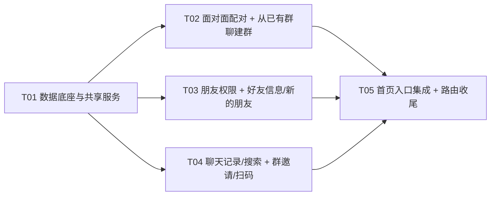

# 微聊 1.1.7 增量系统设计 —— 社交与发现

> 文档类型：增量系统设计 + 任务分解
> 语言：简体中文
> 基线：1.1.6（代码完整可运行）
> 目标：1.1.7
> 作者：架构师（高见远）

---

## 1. 实现方案总览 + 框架/技术选型

### 1.1 本轮目标与总体策略

本轮为**增量迭代**，严格遵守「最小变更、优先复用」：

- 复用现有消息分页（`lib/messages.js#listMessagesBefore`）、分片上传（`lib/uploadChunks.js` + `messages.file` 链路）、二维码（`lib/qr.js` + `user_qr_tokens`）、socket.io 实时通道、`conversation:new/update` 广播、系统消息机制。
- 不引入任何原生编译模块；不引入新 npm 依赖（见 §9）。
- 数据模型沿用 `db.js` 的「`schema.sql` 幂等建表 + `ensureColumn` 幂等补列」迁移模式。

### 1.2 关键难点与选型结论

| 难点 | 结论 | 理由 |
|---|---|---|
| 消息全文搜索 | **FTS5 不可用，采用 LIKE 兜底** | 见 §1.3 实测结论。搜索范围 = `messages.content`（覆盖文本正文 + 名片 JSON 内嵌昵称）+ `messages.file_name`，先 LIKE 落地，保留后续外置 FTS 扩展位。 |
| 朋友权限（方向「我对该好友」） | 新增 `friend_permissions` 表 + 独立领域服务 `lib/friendPermissions.js` | 权限为「有向」关系，与既有 `friendships`（无序对）解耦；朋友圈可见性、单聊发送、通话在各自领域服务内统一调用该服务，避免散落判断。 |
| 面对面数字码配对 | 新增 `face_pairings` + `face_pairing_members`，复用 socket 用户房间推送 | 4 位码 + 5 分钟有效；`file` 上限 2 人、`group` 不限人数（成组需 ≥3 含自己）。 |
| 面对面传文件（服务端中转） | 配对完成后创建/复用单聊会话，`conversations.allow_non_friend_send=1` 临时放行非好友发送 | 复用既有 `upload` + `file` 消息链路；「非好友也可互传」用一个只读放行标志最小化侵入，不新增会话类型。 |
| 群邀请二维码/链接 | 新增 `group_invites` 表 + `lib/groupInvite.js`，复用 token 机制 | 用户码保持原文 token 兼容；群邀请码用 `wlgroup:<token>` 前缀区分，扫码/链接可识别。 |
| 从已有群聊建群 | 复用建群接口，新增 `source_group_id` 校验 | 所选群成员中「仅我的好友」可勾选；后端二次校验「好友 ∩ 源群成员」。 |
| 聊天记录查看只读 | 新页面直接调 `api.messages` 分页，**不调 markRead** | 进入聊天主界面才标已读（沿用现有 `openConversation`）。 |

### 1.3 FTS5 可行性结论（实测）

在目标代码目录下，用当前运行环境实测 `node:sqlite`（`DatabaseSync`）：

```text
node --version           -> v22.13.1（当前环境实测版本）
CREATE VIRTUAL TABLE ... USING fts5(content)
-> Error: no such module: fts5
```

**结论**：`node:sqlite` 内置的 SQLite 未编译 FTS5 模块，**本轮不采用 FTS5**，改为 **LIKE 兜底**：

- 搜索字段：`messages.content LIKE '%kw%' ESCAPE '\' OR messages.file_name LIKE '%kw%' ESCAPE '\'`。
- 名片昵称已在 `card` 消息的 `content`（JSON：`{"type":"card","user_id":..,"nickname":".."}`）内，因此 `content LIKE` 天然覆盖「名片昵称」。
- 大库量下 `%kw%` 无法走索引、需全表扫描，作为已知限制（见 §10），后续若需高性能可评估外置 FTS/倒排，不在本轮范围。

> 说明：PRD 技术栈写 Node 24，当前环境实测为 v22.13.1。无论 22/24，FTS5 均以「本机实测不支持」为准处理，本设计统一按 LIKE 落地。

### 1.4 架构模式

后端维持「Express 路由（薄） → `lib/*` 领域服务（厚，REST 与 socket 共用）」的既有分层；前端维持「pages + components + zustand store + `api.js` + `socket.js`」分层。本轮新增能力分别落入对应领域服务，不引入新架构。

---

## 2. 数据模型变更

### 2.1 新增表（追加到 `server/schema.sql`，幂等 `CREATE TABLE IF NOT EXISTS`）

```sql
-- ------------------------------------------------------------------
-- 朋友权限（方向：owner_id 对 friend_id 的权限，即「我对该好友」）
-- hide_my_moments=不让他看我的朋友圈；hide_his_moments=不看他朋友圈
-- chat_only=仅聊天（等价 ①+② 同时生效）；blocked=加入黑名单（拉黑）
-- ------------------------------------------------------------------
CREATE TABLE IF NOT EXISTS friend_permissions (
  id INTEGER PRIMARY KEY AUTOINCREMENT,
  owner_id INTEGER NOT NULL REFERENCES users(id) ON DELETE CASCADE,
  friend_id INTEGER NOT NULL REFERENCES users(id) ON DELETE CASCADE,
  hide_my_moments INTEGER NOT NULL DEFAULT 0,
  hide_his_moments INTEGER NOT NULL DEFAULT 0,
  chat_only INTEGER NOT NULL DEFAULT 0,
  blocked INTEGER NOT NULL DEFAULT 0,
  updated_at INTEGER NOT NULL,
  UNIQUE (owner_id, friend_id)
);
CREATE INDEX IF NOT EXISTS idx_friend_permissions_owner ON friend_permissions(owner_id);
CREATE INDEX IF NOT EXISTS idx_friend_permissions_friend ON friend_permissions(friend_id);

-- ------------------------------------------------------------------
-- 面对面配对：code=4位数字，5分钟有效；kind=file|group
-- file 上限 2 人（1对1传文件）；group 不限人数（成组需≥3含自己）
-- code 不做全局唯一约束（可跨时间复用），应用层保证 (kind,code) 在有效期内唯一
-- ------------------------------------------------------------------
CREATE TABLE IF NOT EXISTS face_pairings (
  id INTEGER PRIMARY KEY AUTOINCREMENT,
  code TEXT NOT NULL,
  kind TEXT NOT NULL,
  expires_at INTEGER NOT NULL,
  resolved INTEGER NOT NULL DEFAULT 0,
  created_at INTEGER NOT NULL
);
CREATE INDEX IF NOT EXISTS idx_face_pairings_active ON face_pairings(kind, code, expires_at, resolved);

CREATE TABLE IF NOT EXISTS face_pairing_members (
  pairing_id INTEGER NOT NULL REFERENCES face_pairings(id) ON DELETE CASCADE,
  user_id INTEGER NOT NULL REFERENCES users(id) ON DELETE CASCADE,
  joined_at INTEGER NOT NULL,
  PRIMARY KEY (pairing_id, user_id)
);

-- ------------------------------------------------------------------
-- 群邀请令牌：默认 7 天有效；refresh 吊销旧 token
-- 二维码内容 = 'wlgroup:' + token（与用户名片码原文 token 区分）
-- ------------------------------------------------------------------
CREATE TABLE IF NOT EXISTS group_invites (
  id INTEGER PRIMARY KEY AUTOINCREMENT,
  conversation_id INTEGER NOT NULL REFERENCES conversations(id) ON DELETE CASCADE,
  token TEXT NOT NULL UNIQUE,
  created_by INTEGER NOT NULL REFERENCES users(id) ON DELETE CASCADE,
  expires_at INTEGER NOT NULL,
  revoked INTEGER NOT NULL DEFAULT 0,
  created_at INTEGER NOT NULL
);
CREATE INDEX IF NOT EXISTS idx_group_invites_conv ON group_invites(conversation_id);
```

### 2.2 新增字段（追加到 `server/db.js` 的 `COLUMN_MIGRATIONS`）

```js
// 面对面传文件：非好友临时可发（1=允许），单聊发送与只读判定联动
['conversations', 'allow_non_friend_send', 'INTEGER NOT NULL DEFAULT 0'],
```

### 2.3 索引说明

- 消息搜索走 `%kw%` LIKE，无法用 B-Tree 索引，**不新增消息索引**；既有 `idx_msg_conv_id (conversation_id, id DESC)` 用于 `before_id` 分页与命中结果定位。
- `friend_permissions` 双向外键索引用于「我对好友」与「好友对我」两个方向批量判定。
- `face_pairings(kind, code, expires_at, resolved)` 支撑配对查询；`group_invites(conversation_id)` 支撑群维度复用查询。

### 2.4 迁移方式

- 新表：追加到 `schema.sql`，`db.js` 启动时 `db.exec(schemaSql)` 幂等建表，老库自动补表。
- 新列：追加到 `COLUMN_MIGRATIONS`，`ensureColumn` 以 `PRAGMA table_info` 判存在后 `ALTER TABLE`，可反复执行。
- 无破坏性变更，无数据回填需求（新列带 `DEFAULT 0` / 新表初始为空）。

---

## 3. 接口设计

> 约定：所有接口需 `Authorization: Bearer <token>`；成功 `{ok:true, ...}`；失败 `{ok:false, code, message}`。时间戳统一毫秒。

### 3.1 朋友权限

#### `GET /api/friends/:user_id/permission`
- 入参：路径 `user_id`。
- 出参：`{ permission: { hide_my_moments:boolean, hide_his_moments:boolean, chat_only:boolean, blocked:boolean } }`（返回**生效值**：`chat_only`/`blocked` 已折叠进两个 hide）。
- 错误：`403 NOT_FRIEND`（非好友）。

#### `PUT /api/friends/:user_id/permission`
- 入参：`{ hide_my_moments?, hide_his_moments?, chat_only?, blocked? }`（可选布尔，字段缺失不改动）。
- 出参：`{ permission }`（同 GET）。
- 错误：`400 INVALID_PARAM`、`403 NOT_FRIEND`。

### 3.2 面对面配对

#### `POST /api/face-pair/create`
- 入参：`{ kind: 'file' | 'group' }`。
- 出参：`{ pairing_id, code, expires_at, member_count }`。

#### `POST /api/face-pair/join`
- 入参：`{ kind, code }`。
- 出参：
  - `kind=file` 且凑满 2 人：`{ pairing_id, members, conversation_id, peer_user_id }`（同时创建/复用单聊并置 `allow_non_friend_send=1`）。
  - `kind=group`：`{ pairing_id, members }`。
- 错误：`404 PAIR_NOT_FOUND`（码不存在/过期）、`409 PAIR_FULL`（file 已满）、`400 INVALID_PARAM`。

#### `GET /api/face-pair/:id`
- 入参：路径 `id`。
- 出参：`{ pairing: { id, kind, code, expires_at }, members: [{user_id, nickname, avatar_color, avatar_url}] }`。
- 错误：`404 PAIR_NOT_FOUND`、`403 FORBIDDEN`（非成员）。

#### `POST /api/face-pair/group`
- 入参：`{ pairing_id }`。
- 出参：`{ conversation_id }`。
- 错误：`404 PAIR_NOT_FOUND`、`403 FORBIDDEN`（非成员）、`400 PAIR_TOO_FEW`（成员含自己 <3）。
- 说明：允许配对内的**非好友**直接入群（面对面场景）；建群成功后删除配对并推 `face-pair:resolved`。

### 3.3 群聊创建（扩展）

#### `POST /api/conversations/group`（修改）
- 入参：`{ member_ids, name?, source_group_id? }`。
- 规则：
  - 无 `source_group_id`：保持现状（成员必须都是我的好友，≥3 含自己，≤50）。
  - 有 `source_group_id`：额外要求每个 `member_id` **同时是源群成员且是我的好友**（否则 `403 NOT_FRIEND`）。
- 出参：`{ conversation_id }`。
- 错误：`403 NOT_FRIEND`、`400 TOO_FEW_MEMBERS`、`400 GROUP_FULL`、`404 NOT_GROUP`、`403 FORBIDDEN`。

### 3.4 群邀请

#### `POST /api/conversations/:id/invite`（写入 `routes/groups.js`）
- 入参：`{ refresh?: boolean }`。
- 出参：`{ token, qr_content: 'wlgroup:<token>', link, expires_at }`。
- 规则：有效 token 复用；`refresh=true` 或不存在时吊销旧 token 并签发新 token；**P0 放开所有群成员**（仅 `requireMember`，不走 `assertCanInvite`）。
- 错误：`404 NOT_GROUP`、`403 FORBIDDEN`。

#### `POST /api/group-invites/resolve`
- 入参：`{ token }`（兼容 `wlgroup:<token>` 与链接末段）。
- 出参：`{ group: { id, name, avatar_url, member_count }, already_joined: boolean, my_role? }`。
- 错误：`404 GROUP_INVITE_INVALID`（无效/过期/已吊销）。

#### `POST /api/group-invites/join`
- 入参：`{ token }`。
- 出参：`{ conversation_id, already_joined: boolean }`。
- 规则：已入群幂等返回；受群人数上限 50 约束（`400 GROUP_FULL`）；入群后写系统消息、`conversation:new` 给新成员、`conversation:update` 给老成员。
- 错误：`404 GROUP_INVITE_INVALID`、`400 GROUP_FULL`。

### 3.5 消息搜索

#### `GET /api/messages/search`
- 入参（query）：`q`（必填，trim 后 1~32 字）、`type`（可选：`text|image|file|card|voice|video|sticker`，空=全部）、`before_id`（游标，默认 MAX）、`limit`（默认 20，最大 50）。
- 出参：`{ results: [ { message, conversation: { id, type, name, peer } } ], has_more }`。
- 规则：仅搜「我参与的会话」；`revoked=0`；`content`（含名片昵称）+ `file_name` LIKE 匹配。
- 错误：`400 INVALID_PARAM`（`q` 为空/超长、`type` 非法）。

### 3.6 用户详情（扩展）

#### `GET /api/users/:id`（修改）
- 出参新增：
  - `added_at: number|null`：关系为 `friend` 时取 `friendships.created_at`。
  - `common_groups: [{ id, name, member_count }]`：我与目标共同所在群（`type='group'`），按 `id DESC`。

### 3.7 好友申请列表（扩展）

#### `GET /api/friends/requests`（修改）
- 出参每项新增：
  - `updated_at`：处理时间（`friend_requests.updated_at`）。
  - `accepted_at`：`accepted` 条目的 `friendships.created_at`（通过时间，供「新的朋友」已通过条目显示）。

### 3.8 新增 socket 事件（服务端 → 客户端）

| 事件 | 负载 | 触发 |
|---|---|---|
| `face-pair:update` | `{ pairing_id, members }` | 有人加入配对（推给配对内其他成员） |
| `face-pair:ready` | `{ pairing_id, conversation_id, peer_user_id }` | 面对面传文件凑满 2 人 |
| `face-pair:resolved` | `{ pairing_id, conversation_id }` | 面对面建群成功、配对关闭 |

> 客户端 `socket.js` 的 `FORWARD_EVENTS` 需追加这三个事件名。其余（群邀请入群）复用既有 `conversation:new` / `conversation:update`。

### 3.9 关键错误码汇总（新增）

| code | HTTP | 含义 |
|---|---|---|
| `NOT_FRIEND` | 403 | 非好友（复用） |
| `BLOCKED` | 403 | 我拉黑了对方，无法发送/通话 |
| `BLOCKED_BY_PEER` | 403 | 对方拉黑了我（发送方回显「消息已发出，但被对方拒收」） |
| `PAIR_NOT_FOUND` | 404 | 数字码不存在或已过期 |
| `PAIR_FULL` | 409 | 面对面传文件已满（2 人） |
| `PAIR_TOO_FEW` | 400 | 面对面建群人数不足 |
| `GROUP_INVITE_INVALID` | 404 | 群邀请无效/过期/已吊销 |
| `GROUP_FULL` | 400 | 群满 50 人（复用） |

---

## 4. 文件清单（相对路径，标注 新增/修改）

### 后端

| 文件 | 变更 | 所属任务 |
|---|---|---|
| `server/schema.sql` | 修改（新增 4 表 + 索引） | T01 |
| `server/db.js` | 修改（`COLUMN_MIGRATIONS` 加 `allow_non_friend_send`） | T01 |
| `server/lib/friendPermissions.js` | 新增 | T01 |
| `server/lib/conversations.js` | 修改（共享建群 helper、只读判定扩展） | T01 |
| `server/lib/messages.js` | 修改（拉黑拦截 + `allow_non_friend_send` 放行） | T01 |
| `server/lib/calls.js` | 修改（拉黑拦截通话） | T01 |
| `server/lib/moments.js` | 修改（朋友圈权限过滤） | T01 |
| `server/lib/facePair.js` | 新增 | T02 |
| `server/routes/facePair.js` | 新增 | T02 |
| `server/routes/conversations.js` | 修改（建群支持 `source_group_id`） | T02 |
| `server/routes/friends.js` | 修改（权限路由 + 申请列表日期） | T03 |
| `server/routes/users.js` | 修改（`GET /:id` 加 `added_at`/`common_groups`） | T03 |
| `server/lib/messageSearch.js` | 新增 | T04 |
| `server/routes/messages.js` | 修改（加 `/messages/search`） | T04 |
| `server/lib/groupInvite.js` | 新增 | T04 |
| `server/routes/groupInvite.js` | 新增 | T04 |
| `server/routes/groups.js` | 修改（群邀请生成/刷新） | T04 |
| `server/index.js` | 修改（挂载 `face-pair` / `group-invites` 路由） | T05 |

### 前端

| 文件 | 变更 | 所属任务 |
|---|---|---|
| `web/src/api.js` | 修改（新增全部 API 方法） | T01 |
| `web/src/config.js` | 修改（新增常量） | T01 |
| `web/src/lib/time.js` | 修改（新增 `formatDateOnly`） | T01 |
| `web/src/lib/errorText.js` | 修改（新增错误码文案） | T01 |
| `web/src/socket.js` | 修改（转发 `face-pair:*` 事件） | T02 |
| `web/src/store/useChat.js` | 修改（`createGroup` 支持 `source_group_id`；面对面相关调用） | T02 |
| `web/src/pages/FacePairPage.jsx` | 新增（面对面配对：传文件/建群） | T02 |
| `web/src/pages/GroupCreatePage.jsx` | 修改（三种建群方式切换） | T02 |
| `web/src/components/FriendPermissionSheet.jsx` | 新增（朋友权限弹层） | T03 |
| `web/src/pages/UserInfoPage.jsx` | 修改（添加日期/共同群聊/权限入口） | T03 |
| `web/src/pages/NewFriendsPage.jsx` | 修改（显示添加/处理日期） | T03 |
| `web/src/pages/ChatHistoryPage.jsx` | 新增（聊天记录只读查看） | T04 |
| `web/src/pages/MessageSearchPage.jsx` | 新增（消息全文搜索） | T04 |
| `web/src/pages/ChatPage.jsx` | 修改（「查看聊天记录」入口） | T04 |
| `web/src/pages/GroupInfoPage.jsx` | 修改（群邀请二维码/链接入口） | T04 |
| `web/src/pages/ScanPage.jsx` | 修改（识别用户码/群邀请码） | T04 |
| `web/src/pages/GroupJoinPage.jsx` | 新增（打开邀请链接入群） | T04 |
| `web/src/pages/ChatsPage.jsx` | 修改（放大镜 + 「+」菜单 4 项） | T05 |
| `web/src/pages/DiscoverPage.jsx` | 修改（移除签名卡片） | T05 |
| `web/src/store/useUI.js` | 修改（注册新路由名） | T05 |
| `web/src/App.jsx` | 修改（Sidebar 菜单/桌面搜索扩展/新页面路由） | T05 |

---

## 5. 依赖图与实现顺序

### 5.1 任务依赖图



### 5.2 有序任务列表

#### T01 数据底座与共享服务（基础设施 + 领域 lib + 前端 API/常量）【P0】
- **涉及文件**：`server/schema.sql`、`server/db.js`、`server/lib/friendPermissions.js`、`server/lib/conversations.js`、`server/lib/messages.js`、`server/lib/calls.js`、`server/lib/moments.js`、`web/src/api.js`、`web/src/config.js`、`web/src/lib/time.js`、`web/src/lib/errorText.js`
- **要点**：
  1. schema/db：新增 4 表 + 索引 + `allow_non_friend_send` 列迁移。
  2. `friendPermissions`：`getPermission/setPermission/isBlocked/canSeeMoments` 与生效值折叠（`chat_only`/`blocked` 隐含双向隐藏）。
  3. `conversations`：抽 `createGroupConversation({ownerId, memberIds, name, allowNonFriends})` 共享建群；`conversationDetail` 与列表只读判定加入 `blocked` 与 `allow_non_friend_send`。
  4. `messages`：单聊发送校验加入「拉黑拦截 + `allow_non_friend_send` 放行」。
  5. `calls`：`inviteCall` 拉黑拦截。
  6. `moments`：`listTimeline`/`listUserMoments`/`assertVisibleMoment` 接入权限过滤（批量查权限，避免 N+1）。
  7. 前端 `api.js` 补齐 §3 全部方法；`config.js` 加 `FACE_PAIR_CODE_LEN=4`、`FACE_PAIR_TTL_MS=5*60*1000`、`GROUP_INVITE_TTL_MS=7*24*3600*1000`、`SEARCH_PAGE_SIZE=20` 等；`time.js` 加 `formatDateOnly`；`errorText.js` 加 §3.9 新错误码文案。
- **依赖**：无。
- **验收**：启动日志无迁移报错、新表存在、既有功能不回归；`api.js` 新方法可被调用；单聊/通话/朋友圈的权限过滤逻辑经手动路径覆盖。

#### T02 面对面配对 + 从已有群聊建群【P0】
- **涉及文件**：`server/lib/facePair.js`、`server/routes/facePair.js`、`server/routes/conversations.js`、`web/src/socket.js`、`web/src/store/useChat.js`、`web/src/pages/FacePairPage.jsx`、`web/src/pages/GroupCreatePage.jsx`
- **要点**：
  1. `facePair`：4 位码生成（惰性清理过期）、`create/join/get/createGroupFromPairing`；`file` 满 2 人创建单聊并置 `allow_non_friend_send=1`；`group` 建群复用 `createGroupConversation(allowNonFriends=true)`。
  2. `routes/facePair.js`：§3.2 四个接口；`routes/conversations.js`：建群支持 `source_group_id`。
  3. `socket.js` 转发 `face-pair:update/ready/resolved`；`useChat.createGroup` 支持第三参 `sourceGroupId`。
  4. `GroupCreatePage`：顶部「选择好友 / 面对面建群 / 从已有群聊建群」切换；已有群聊建群时非好友置灰。
  5. `FacePairPage`：展示我的码 + 输入对方码 + 成员列表 + 确认成组/发文件。
- **依赖**：T01。
- **验收**：面对面传文件 1 对 1 配对后进入普通文件发送；面对面建群 ≥3 人成组进入新群；已有群聊建群仅好友可勾选且后端校验通过。

#### T03 朋友权限接口 + 好友信息页/新的朋友增强【P1】
- **涉及文件**：`server/routes/friends.js`、`server/routes/users.js`、`web/src/components/FriendPermissionSheet.jsx`、`web/src/pages/UserInfoPage.jsx`、`web/src/pages/NewFriendsPage.jsx`
- **要点**：
  1. `routes/friends.js`：`GET/PUT /friends/:user_id/permission`；`GET /friends/requests` 返回 `updated_at`/`accepted_at`。
  2. `routes/users.js`：`GET /users/:id` 返回 `added_at`、`common_groups`。
  3. `FriendPermissionSheet`：4 开关（仅聊天联动两个 hide、拉黑二次确认）。
  4. `UserInfoPage`：好友态显示添加日期、共同群聊（可点击进群）、「朋友权限」入口。
  5. `NewFriendsPage`：已通过显示 `accepted_at`，待处理显示 `created_at`，已拒绝显示 `updated_at`。
- **依赖**：T01。
- **验收**：权限设置即时生效并刷新朋友圈；好友信息页日期/共同群聊正确；新的朋友日期口径符合决策。

#### T04 聊天记录查看 + 消息全文搜索 + 群邀请二维码/链接 + 扫一扫识别【P0】
- **涉及文件**：`server/lib/messageSearch.js`、`server/routes/messages.js`、`server/lib/groupInvite.js`、`server/routes/groupInvite.js`、`server/routes/groups.js`、`web/src/pages/ChatHistoryPage.jsx`、`web/src/pages/MessageSearchPage.jsx`、`web/src/pages/ChatPage.jsx`、`web/src/pages/GroupInfoPage.jsx`、`web/src/pages/ScanPage.jsx`、`web/src/pages/GroupJoinPage.jsx`
- **要点**：
  1. `messageSearch`：`searchMessages`（我参与的会话 + LIKE + 类型过滤 + `before_id` 分页）；`routes/messages.js` 加 `GET /messages/search`。
  2. `groupInvite`：token 生成/复用/刷新（吊销旧码）/解析/入群；`routes/groupInvite.js` 挂 `/api/group-invites`；`routes/groups.js` 加邀请生成/刷新。
  3. `ChatHistoryPage`：只读分页 + 日期分组 + 类型筛选，**不调 markRead**；`ChatPage` 加「查看聊天记录」入口。
  4. `MessageSearchPage`：按会话分组、命中高亮、点击进会话。
  5. `GroupInfoPage`：群二维码/链接入口 + 刷新；`ScanPage`：识别 `wlgroup:` 前缀跳群邀请；`GroupJoinPage`：打开 `#/join/<token>` 链接入群。
- **依赖**：T01（可与 T02/T03 并行）。
- **验收**：搜索按会话分组、类型过滤、点击进会话；聊天记录只读不标已读；群邀请码/链接生成、刷新、入群受 50 人约束；扫码/链接可识别群邀请。

#### T05 首页入口集成 + 路由收尾 + 发现页移除签名卡片【P0】
- **涉及文件**：`server/index.js`、`web/src/pages/ChatsPage.jsx`、`web/src/pages/DiscoverPage.jsx`、`web/src/store/useUI.js`、`web/src/App.jsx`
- **要点**：
  1. `index.js`：挂载 `facePairRouter`（`/api/face-pair`）与 `groupInviteRouter`（`/api/group-invites`）。
  2. `ChatsPage`：移动端顶栏「+」左侧放大镜；「+」菜单改为 4 项（扫一扫 → 面对面传文件 → 发起群聊 → 添加朋友）。
  3. `App.jsx`：桌面 Sidebar「+」菜单同步 4 项；桌面搜索框非空时提供「搜索聊天记录」入口；`DesktopPane`/`MobilePane` 注册 `facePair`/`chatHistory`/`messageSearch`/`groupJoin` 路由分支。
  4. `useUI.js`：`ROUTE_NAMES` 追加上述新路由名（`groupJoin` 带 id 或 token 处理）。
  5. `DiscoverPage`：删除 `embedded` 分支「头像 + 签名」卡片（约 73-88 行）。
- **依赖**：T02、T03、T04。
- **验收**：首页菜单/放大镜/新页面可正常导航；发现页签名卡片移除、三项入口保留。

---

## 6. 关键数据结构与接口签名

### 6.1 领域服务签名（简化为代码块）

```js
// server/lib/friendPermissions.js
getPermission(ownerId, friendId) -> { hide_my_moments, hide_his_moments, chat_only, blocked }  // 生效值
setPermission(ownerId, friendId, patch) -> permission
isBlocked(a, b) -> boolean          // 任一方向 blocked
canSeeMoments(viewerId, authorId) -> boolean
hideMyMomentsOf(ownerId, friendId) -> boolean
hideHisMomentsOf(ownerId, friendId) -> boolean

// server/lib/facePair.js
createPairing(userId, kind) -> { pairing_id, code, expires_at, member_count }
joinPairing(userId, kind, code) -> { pairing_id, members, conversation_id?, peer_user_id? }
getPairing(pairingId, userId) -> { pairing, members }
createGroupFromPairing(pairingId, userId) -> { conversation_id }

// server/lib/groupInvite.js
getOrCreateInvite(conversationId, userId) -> { token, qr_content, link, expires_at }
refreshInvite(conversationId, userId) -> invite
resolveInvite(token) -> { group, already_joined, my_role? }
joinByInvite(token, userId) -> { conversation_id, already_joined }

// server/lib/messageSearch.js
searchMessages({ userId, query, type, beforeId, limit }) -> { results, has_more }

// server/lib/conversations.js（扩展）
createGroupConversation({ ownerId, ownerNickname, memberIds, name, allowNonFriends }) -> { conversationId, members }
```

### 6.2 前端 store/API 签名（简化为代码块）

```js
// web/src/api.js 新增
friendsPermission(userId) -> GET  /friends/:userId/permission
updateFriendsPermission(userId, patch) -> PUT /friends/:userId/permission
facePairCreate(kind) -> POST /face-pair/create
facePairJoin(kind, code) -> POST /face-pair/join
facePairDetail(id) -> GET /face-pair/:id
facePairCreateGroup(pairingId) -> POST /face-pair/group
createGroupInvite(id, refresh) -> POST /conversations/:id/invite
resolveGroupInvite(token) -> POST /group-invites/resolve
joinGroupInvite(token) -> POST /group-invites/join
searchMessages({ q, type, before_id, limit }) -> GET /messages/search

// web/src/store/useChat.js（扩展）
createGroup(memberIds, name, sourceGroupId) -> conversationId

// web/src/lib/time.js 新增
formatDateOnly(timestamp) -> 'YYYY/M/D'
```

### 6.3 类图

见 `docs/class-diagram.mermaid`（正文同 §1.4 架构分层；核心领域类关系见该文件）。

---

## 7. 程序调用流程（关键场景时序图）

> 完整时序见 `docs/sequence-diagram.mermaid`。以下为文字要点。

### 7.1 面对面建群配对

A 创建码 → 落库 + A 入房；B、C 输同码 → 校验有效 + 入房 + `face-pair:update` 广播；A 确认成组 → `createGroupFromPairing`（校验 ≥3 含自己）→ 复用 `createGroupConversation(allowNonFriends=true)` 建群 → `conversation:new` 给成员 + `face-pair:resolved` + 删配对。

### 7.2 面对面传文件

A 创建码（kind=file）；B 输码 → `joinPairing` 校验未满 → 满 2 人时创建/复用单聊并置 `allow_non_friend_send=1` → 返回 `conversation_id + peer_user_id` → `face-pair:ready` 广播 → 前端复用现有文件上传 + `file` 消息发送链路。

### 7.3 群邀请入群

扫码/链接 → 取 token → `resolveInvite`（校验未吊销未过期，返回群信息 + 是否已入群）→ 用户确认 → `joinByInvite`（校验 50 人上限 → 加成员 → 系统消息 → `conversation:new` + `conversation:update`）→ 前端进群。

### 7.4 消息搜索

输入关键词 → `GET /messages/search` → `searchMessages`（`conversation_members.user_id=me` 限定我参与的会话 + `content`/`file_name` LIKE + 类型过滤 + `id<before_id` 倒序）→ 返回 `[{message, conversation}]` → 前端按会话分组、高亮命中、点击进会话。

### 7.5 朋友圈权限过滤

浏览者拉时间线 → `listTimeline` 取好友集合 → 批量查两个方向权限（我对其 `hide_his`、其对我 `hide_my`）→ 过滤不可见作者 → 返回过滤后时间线；单条/他人主页沿用 `canSeeMoments`。

---

## 8. 共享知识（跨文件约定）

1. **新消息类型**：本轮**不新增**消息类型。面对面传文件复用 `file`；群邀请入群/面对面建群写 `system` 消息。
2. **权限字段命名**：DB 用 `hide_my_moments / hide_his_moments / chat_only / blocked`（0/1 整数）；API 出参为布尔，且返回**生效值**（`chat_only`、`blocked` 折叠进两个 hide）。
3. **权限方向**：`friend_permissions.owner_id` = 我，`friend_id` = 对方，即「我对该好友」。
4. **面对面**：码 4 位（1000-9999）、5 分钟有效；`kind=file` 上限 2 人、`kind=group` 不限（成组 ≥3 含自己）；码在 (kind, 有效期内) 应用层唯一，惰性清理过期。
5. **群邀请**：二维码内容 `wlgroup:<token>`，链接 `#/join/<token>`；7 天有效；刷新即吊销旧码；入群直接加入受 50 人上限约束。
6. **日期口径**：好友信息页「添加日期」=`friendships.created_at`；「新的朋友」已通过显示 `friendships.created_at`、待处理显示 `friend_requests.created_at`、已拒绝显示 `friend_requests.updated_at`；前端统一用 `formatDateOnly` 输出 `YYYY/M/D`。
7. **聊天记录只读**：`ChatHistoryPage` 只调 `api.messages` 分页，**不调 `markRead`**；进入聊天主界面才标已读（沿用 `openConversation`）。
8. **错误码**：统一沿用 `ApiError(status, code, message)`；新增码见 §3.9，前端 `errorText.js` 需补文案。
9. **时间**：一律毫秒时间戳，`db.now()` 为唯一时间源。
10. **实时事件**：新 `face-pair:*` 事件经 `emitToUsers` 推用户房间；前端 `socket.js` `FORWARD_EVENTS` 需同步。

---

## 9. 依赖包清单

**零新增 npm 依赖。**

- 后端：继续使用 `express` / `socket.io` / `jsonwebtoken` / `bcryptjs` / `multer` + 内置 `node:sqlite` / `node:crypto`。
- 前端：继续使用 `react` / `react-dom` / `zustand` / `socket.io-client` / `jsqr` / `qrcode`（群邀请二维码前端生成复用现有 `qrcode` 包）。

---

## 10. 待明确事项

1. **FTS5/大库量**：当前 `node:sqlite` 无 FTS5，本轮 LIKE 兜底在大消息量下为全表扫描；后续是否引入外置 FTS/倒排需另行评估（本轮不实现）。
2. **Node 版本差异**：PRD 写 Node 24，当前环境实测 v22.13.1；FTS5 结论以本机实测为准。若目标环境 Node 24 的 `node:sqlite` 已编译 FTS5，可复用同一 `lib/messageSearch.js` 接口替换底层实现，不改路由与前端契约。
3. **面对面传文件会话残留**：配对成功创建的「临时单聊」会出现在会话列表（可继续作为普通会话使用），本轮不做自动隐藏/清理；是否需要「仅传文件、不入会话列表」需产品确认。
4. **拉黑后的会话列表表现**：按决策「保留会话、只读」实现（列表仍显示、可看历史、不可发送/通话）。是否需要「拉黑后从列表隐藏」未明确，本轮不隐藏。
5. **面对面建群群名**：沿用现有缺省群名规则（前 3 人昵称拼接），未单独定义「面对面建群」命名偏好。
6. **群邀请入群系统消息文案**：拟为「xxx 通过群邀请加入了群聊」，可后续按产品文案调整。
7. **消息搜索命中的「定位到消息」**：本轮实现「进入会话」，是否做到精确滚动定位到命中消息未在本轮强约束（PRD 措辞为「尽量定位」），实现时优先保证进会话、定位作为增强。
8. **名片推送（P2）**：1.1.6 已实现，本轮仅复核，不改代码。

---

## 附：需求 → 任务映射速览

| 需求 | 任务 |
|---|---|
| ① 首页+号菜单（扫一扫/面对面传文件） | T05（入口）、T02（FacePairPage） |
| ② 发起群聊（面对面/已有群） | T02 |
| ③ 群聊私聊查看聊天记录 | T04 |
| ④ 首页消息全文搜索 | T04（搜索）、T05（放大镜入口） |
| ⑤ 新的朋友显示日期 | T03 |
| ⑥ 好友信息页日期 + 共同群聊 | T03 |
| ⑦ 朋友权限 | T01（领域/过滤）、T03（路由/UI） |
| ⑧ 群邀请二维码/链接 | T04 |
| ⑨ 名片推送 | P2 复核（无新增） |
| ⑩ 发现页移除签名卡片 | T05 |
