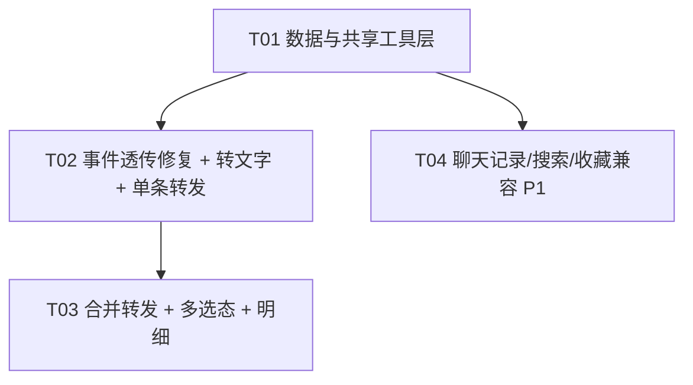
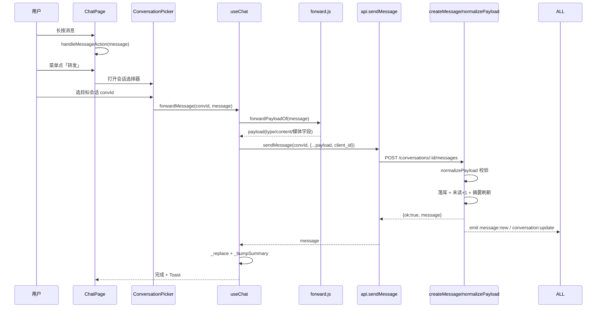
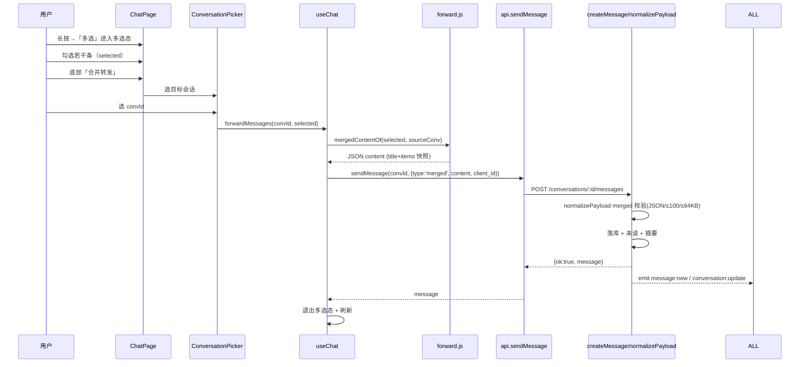
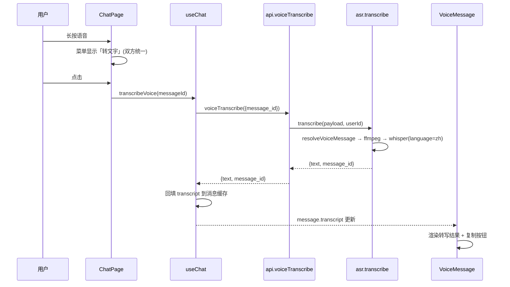
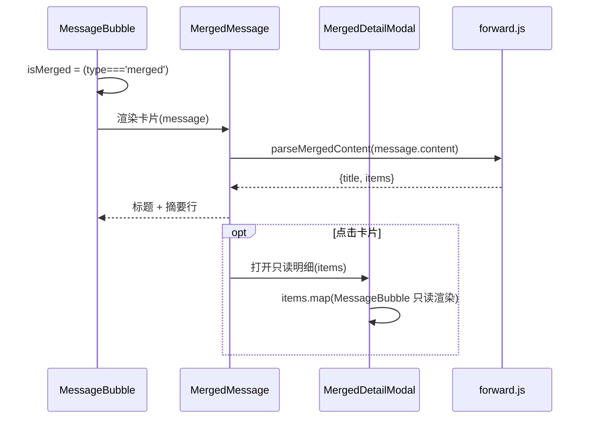

# 微聊 1.1.8 增量架构设计 —— 转发与语音转文字

> 文档类型：增量系统设计 + 任务分解
> 基线版本：1.1.7（前后端同仓，完整可运行）
> 目标版本：1.1.8
> 代码位置：`/workspace/dev/weiliao/`
> 技术栈硬约束：后端 Node.js ESM + Express + SQLite（`node:sqlite` DatabaseSync，禁原生模块，零新增 npm 依赖）；前端 Vite + React 18 + Tailwind 3 + zustand + hash 路由

---

## 0. 主理人决策速览（据此设计，不再提确认）

| # | 决策点 | 结论 |
|---|---|---|
| 1 | 合并卡片点击展示 | 只读 Modal 弹层，复用 `MessageBubble` 渲染被合并条目，不新增路由 |
| 2 | 多选态进出 | 长按菜单点「多选」进入；顶部「已选择 N 条」；底部「逐条转发/合并转发/取消」（P2 删除/收藏可选）；完成或取消即退出；多选态下长按=勾选/取消 |
| 3 | 逐条转发身份 | 不保留原发送者，sender=当前用户；文本丢弃 mentions |
| 4 | 合并转发与搜索 | merged 计入聊天记录/搜索，摘要 `[聊天记录]`；被合并文本纳入关键词检索 |
| 5 | merged content | content 存 JSON 字符串；条数 ≤100；每条摘要截断（文本≤50字，图片`[图片]`、语音`[语音]`、视频`[视频]`、文件`[文件]`、名片`[名片]`、表情`[表情]`）；content 总长 ≤64KB |
| 6 | 合并标题 | 单聊=对方昵称+"的聊天记录"，群聊=群名+"的聊天记录"（跨会话取原会话名） |
| 7 | 多选删除/收藏 | P2 可选，非硬指标；删除做本地隐藏，不做服务端持久化删除 |
| 8 | 卡片失效 | 快照冻结（合并时拷贝摘要，原消息撤回/删除不影响卡片） |
| 9 | 转文字语言 | 双方语音固定中文转写（language=zh），统一文案「转文字」 |
| 10 | 转发媒体 | 复用原 `/uploads` 地址不重传；按类型补齐 voice_duration/video_duration/file_name/file_size |

---

## 1. 实现方案总览

### 1.1 核心难点与选型

| 难点 | 分析 | 方案 |
|---|---|---|
| 长按事件丢失（语音/文件/名片/视频） | `MessageBubble` 用 `cloneElement(content, {...手势事件})` 挂事件，文本/图片/表情是原生 `div/button` 直接生效；四个自定义子组件只解构自己用到的 props、未透传 `rest`，事件落不到根 DOM | 四个子组件统一 `({ ..., ...rest })` 并把 `...rest` 铺到根 DOM（零新依赖，最小改动） |
| 好友语音菜单文案错误 | `ChatPage` 用 `sender_id===myId?'转文字':'翻译'`；后端 whisper 实际 `language=zh` | 统一为「转文字」，删掉 isMine 分支 |
| 逐条转发 | 本质是「复制 type+content 到目标会话再发一条」；媒体直接复用 `/uploads` 地址 | 前端组装 payload，复用 `_send → POST /conversations/:id/messages` |
| 合并转发（新增消息类型） | `content` 为 TEXT 可承载 JSON；`ALLOWED_TYPES`/`normalizePayload` 无 `merged` 分支；前端 `MessageBubble` 非文本排除列表未含 merged 会误走文本渲染 | 后端加 `merged` 分支校验 content JSON；前端加 merged 渲染分支 + 卡片 + 只读明细 |
| 搜索/聊天记录/收藏兼容 | merged 的 JSON 原文会被摘要/摘要函数当文本直出 | `summarizeLastMessage`/`snippetOf`/`messageSummary` 加 `merged → '[聊天记录]'`；关键词检索靠 content JSON 内嵌文本天然被 `LIKE` 命中 |

**不新增 npm 依赖、不新增路由、不新增数据库表/列/索引**，严格最小变更。

### 1.2 merged 消息端到端数据流

```
用户多选 N 条消息
   │  ChatPage 多选态（selected: message[]）
   ▼
forward.js: mergedContentOf(selected, sourceConversation)
   │  ① 按原会话生成 title（对方昵称/群名 + "的聊天记录"）
   │  ② 逐条生成快照 item（sender 昵称/头像 + 类型 + content + 截断 summary + 媒体字段）
   │  ③ JSON.stringify → content（条数≤100，字节≤64KB，超出按序截断）
   ▼
useChat.forwardMessages(convId, selected) → _send(convId, {type:'merged', content})
   ▼
api.sendMessage → POST /conversations/:id/messages
   ▼
server/lib/messages.js: createMessage → normalizePayload（merged 分支：JSON.parse 合法性 + 结构 + 条数/字节上限）
   ▼
落库 messages.content=JSON；未读+1；会话摘要刷新
   ▼
emitToConversation('message:new') + notifyConversationUpdate（socket 四端广播）
   ▼
对端 MessageBubble 识别 type='merged' → MergedMessage 卡片（title + 摘要行）
   ▼
点击卡片 → MergedDetailModal（只读，复用 MessageBubble 逐条渲染 items）
```

---

## 2. 数据模型变更

**结论：无需新增表、无需新增列、无需迁移、无需新增索引。**

核实依据（已读代码）：

1. `messages.content` 为 `TEXT NOT NULL DEFAULT ''`（`server/schema.sql` 第 59-68 行），可承载 merged 的 JSON 字符串，与 `card` 消息存 JSON 的既有模式一致。
2. `createMessage` 落库时 `payload.content` 直接写入 `content` 列（`server/lib/messages.js` 第 333-351 行），无需为 merged 增加任何列。
3. `serializeMessage` 对 `content` 原样透传（`server/lib/serialize.js` 实际在 `server/lib/messages.js` 第 54-79 行），撤回时才置空；merged 无需特殊序列化字段。
4. `messages` 表现有索引（`idx_msg_conv_id`、`idx_msg_id`、`uq_msg_client`）已覆盖 merged 的读写与幂等，无需新增。
5. 搜索 `messageSearch.js` 用 `content LIKE` 兜底，merged 的 JSON 内嵌文本天然可被检索，无需建 FTS/新索引。

**应用层约束（非 DB 约束）**：`merged` 的 `content` 需满足「合法 JSON + items 数组 ≤100 + `Buffer.byteLength(content,'utf8') ≤ 64KB`」，由 `normalizePayload` 校验、前端 `mergedContentOf` 预截断。

---

## 3. 接口设计

**结论：逐条转发与合并转发均复用 `POST /conversations/:id/messages`，不新增 `/messages/forward` 等路由。**

评估理由：`createMessage` 已统一 REST 与 Socket 的落库/权限校验/幂等/未读/摘要/广播链路；逐条转发只是「换 type+content 再发一次」，合并转发只是「新增 type='merged' + JSON content」。新增独立路由会重复权限、幂等、广播逻辑，破坏「单一发送管线」，违背最小变更原则。唯一后端改动是 `normalizePayload` 增加 `merged` 分支校验。

### 3.1 修改：`POST /api/conversations/:id/messages`（既有发送入口）

| 项 | 内容 |
|---|---|
| 方法/路径 | `POST /api/conversations/:id/messages`（登录态 `httpAuth`） |
| 入参 body | `{ type, content, client_id, mentions?, voice_duration?, video_duration?, file_name?, file_size? }` |
| `type='merged'` 时 | `content` = 合并转发 JSON 字符串（schema 见第 6 节），`client_id` 必填，其余字段忽略 |
| 出参（成功） | `{ ok:true, message, duplicate:false }`，`message` 为 `serializeMessage` 统一结构（含 `type='merged'`、`content=JSON 字符串`） |
| 出参（幂等命中） | `{ ok:true, message, duplicate:true }` |

### 3.2 后端 `normalizePayload` 新增 merged 分支（`server/lib/messages.js`）

```js
// ALLOWED_TYPES 增加 'merged'
const ALLOWED_TYPES = new Set([..., 'merged']);

// normalizePayload 内新增：
if (normalizedType === 'merged') {
  let parsed = null;
  try { parsed = JSON.parse(raw); } catch { parsed = null; }
  if (!parsed || typeof parsed !== 'object' || parsed.v !== 1
      || typeof parsed.title !== 'string' || !Array.isArray(parsed.items)
      || parsed.items.length < 1 || parsed.items.length > MERGED_MAX_ITEMS) {
    throw new ApiError(400, 'INVALID_PARAM', '合并转发的 content 必须是合法的 merged JSON 结构');
  }
  if (Buffer.byteLength(raw, 'utf8') > MERGED_MAX_BYTES) {
    throw new ApiError(400, 'INVALID_PARAM', '合并转发内容过大（上限 64KB）');
  }
  return { type: 'merged', content: raw, clientId: normalizedClientId };
}
```

### 3.3 错误码（复用既有，无新增错误码）

| HTTP | code | 场景 |
|---|---|---|
| 400 | `INVALID_PARAM` | merged JSON 非法 / 结构非法 / 条数>100 / 字节>64KB；`client_id` 缺失；其余类型参数非法 |
| 403 | `CONVERSATION_READONLY` | 目标单聊已非好友（只读），转发被拦截 |
| 403 | `BLOCKED` / `BLOCKED_BY_PEER` | 拉黑拦截（沿用发送管线） |
| 403 | `SPEAK_FORBIDDEN` | 目标群「仅管理员可发言」 |
| 404 | `NOT_FOUND` | 会话不存在 / 名片用户不存在（card 转发时） |

其余既有路由（`GET /conversations/:id/messages`、`GET /messages/search`、`GET /messages/sync`）因 `serializeMessage` 原样透传 content，对 merged **透明兼容，无需改动**。

---

## 4. 文件清单

### 后端

| 相对路径 | 变更 | 说明 |
|---|---|---|
| `server/lib/messages.js` | 修改 | `ALLOWED_TYPES` + `normalizePayload` 增加 `merged` 分支；导出 `MERGED_TYPE/MERGED_MAX_ITEMS/MERGED_MAX_BYTES` |
| `server/lib/messageSearch.js` | 修改（P1） | `SEARCH_TYPES` 增加 `merged`（允许 `type=merged` 过滤；关键词检索无需改逻辑） |

### 前端

| 相对路径 | 变更 | 说明 |
|---|---|---|
| `web/src/lib/forward.js` | 新增 | `forwardPayloadOf` / `mergedContentOf` / `mergedSummaryOf` / `parseMergedContent` + merged 常量 |
| `web/src/lib/format.js` | 修改 | `summarizeLastMessage` 增加 `merged → '[聊天记录]'` |
| `web/src/components/VoiceMessage.jsx` | 修改 | 透传 `...rest` 到根 DOM |
| `web/src/components/FileMessage.jsx` | 修改 | 透传 `...rest`（`<a>` 与 `<div>` 两分支根节点） |
| `web/src/components/CardMessage.jsx` | 修改 | 透传 `...rest`（含降级 span 分支） |
| `web/src/components/VideoMessage.jsx` | 修改 | 透传 `...rest`（未播放 button / 播放中 video 两分支） |
| `web/src/components/MessageBubble.jsx` | 修改 | 识别 `isMerged` 排除文本渲染，新增 merged 分支渲染 `MergedMessage` |
| `web/src/components/MergedMessage.jsx` | 新增 | 合并转发卡片（title + 摘要行），自持明细弹层开关 |
| `web/src/components/MergedDetailModal.jsx` | 新增 | 只读明细弹层，复用 `MessageBubble` 逐条渲染 items |
| `web/src/components/ConversationPicker.jsx` | 新增 | 目标会话选择器（单聊+群聊，只读置灰，搜索过滤） |
| `web/src/pages/ChatPage.jsx` | 修改 | 转文字文案统一；菜单加「转发/多选」；多选态 + 底部操作栏 + 集成各弹层 |
| `web/src/store/useChat.js` | 修改 | 新增 `forwardMessage` / `forwardMessages` |
| `web/src/pages/ChatHistoryPage.jsx` | 修改（P1） | 类型筛选加「聊天记录」；merged 走卡片渲染 |
| `web/src/pages/MessageSearchPage.jsx` | 修改（P1） | `snippetOf` + 类型筛选加 merged→`[聊天记录]` |
| `web/src/pages/FavoritesPage.jsx` | 修改（P1） | `messageSummary` 加 merged→`[聊天记录]` |

> 说明：本轮**零新增依赖、零配置文件变更、无入口文件改动**，故不存在「配置文件 + 入口」类基础设施任务；T01 以「后端放行 + 共享工具/常量」承担功能基础设施角色（详见第 5 节）。

---

## 5. 依赖图与实现顺序

### 5.1 任务依赖图



### 5.2 有序任务列表

#### T01 · 数据与共享工具层（功能基础设施）

- **涉及文件**：`server/lib/messages.js`（改）、`server/lib/messageSearch.js`（改，P1）、`web/src/lib/forward.js`（新）、`web/src/lib/format.js`（改）
- **要点**：
  1. 后端 `ALLOWED_TYPES` 增加 `'merged'`；`normalizePayload` 增加 merged 分支（JSON 合法性 + `v===1` + `title` 字符串 + `items` 非空数组 + 条数≤100 + 字节≤64KB）；导出 `MERGED_TYPE/MERGED_MAX_ITEMS/MERGED_MAX_BYTES`。
  2. `messageSearch.js` 的 `SEARCH_TYPES` 增加 `'merged'`（关键词检索逻辑不动，content LIKE 天然命中 JSON 内文本）。
  3. `forward.js`：`forwardPayloadOf(message)`（text 丢 mentions；voice/video/file 补齐 `*_duration`/`file_name`/`file_size`；image/sticker/card 原样）；`mergedSummaryOf(message)`（文本≤50字截断，其余占位）；`mergedContentOf(messages, source)`（title + items 快照 + 条数/字节截断）；`parseMergedContent(content)`（容错解析，供渲染复用）。
  4. `format.js`：`summarizeLastMessage` 增加 `if (type==='merged') return mine?'我: [聊天记录]':'[聊天记录]'`。
- **依赖**：无
- **验收**：后端接受 `type='merged'` 合法 JSON；非法/超 100 条/超 64KB 返回 `400 INVALID_PARAM`；`forwardPayloadOf` 对 7 种类型输出正确 payload；`mergedContentOf` 生成合法 JSON 且带预截断 summary；会话列表摘要显示 `[聊天记录]`。

#### T02 · 事件透传修复 + 转文字文案统一 + 单条转发

- **涉及文件**：`web/src/components/VoiceMessage.jsx`（改）、`web/src/components/FileMessage.jsx`（改）、`web/src/components/CardMessage.jsx`（改）、`web/src/components/VideoMessage.jsx`（改）、`web/src/pages/ChatPage.jsx`（改）、`web/src/store/useChat.js`（改）
- **要点**：
  1. 四个子组件签名改为 `({ ...props, ...rest })`（保留现有解构），根 DOM 元素 `{...rest}`；`FileMessage` 的 `<a>`/`<div>`、`VideoMessage` 的 button/video、`CardMessage` 的 button/降级 span 均需透传，保证 `cloneElement` 注入的 `onPointerDown/onPointerUp/onPointerLeave/onPointerCancel/onContextMenu` 落到根节点。
  2. `ChatPage` 语音菜单 `actionMessage.sender_id === myId ? '转文字' : '翻译'` 统一为 `'转文字'`。
  3. `ChatPage` 长按菜单新增「转发」（菜单顺序建议：转发 → 多选 → 收藏 →（语音）转文字 → 撤回 → 取消）。
  4. `useChat.forwardMessage(conversationId, message)`：`forwardPayloadOf(message)` 组装 payload → 复用发送管线（见共享知识「转发到非活跃会话的缓存一致性」）。
  5. 单条转发复用 `ConversationPicker`（若 T03 未完成可先做最小版，T03 内完善）。
- **依赖**：T01（`forward.js`）
- **验收**：长按/右键语音/文件/名片/视频均弹菜单且不影响自身点击；双方语音菜单均为「转文字」；单条任意类型可转发，sender 为当前用户、text 无 @、媒体复用地址、只读会话被拦截并提示。

#### T03 · 合并转发 + 多选态 + 明细

- **涉及文件**：`web/src/components/MessageBubble.jsx`（改）、`web/src/components/MergedMessage.jsx`（新）、`web/src/components/MergedDetailModal.jsx`（新）、`web/src/components/ConversationPicker.jsx`（新）、`web/src/pages/ChatPage.jsx`（改）、`web/src/store/useChat.js`（改）
- **要点**：
  1. `MessageBubble` 增加 `const isMerged = message.type === 'merged'`；把 `isMerged` 加入文本排除列表；渲染 `<MergedMessage message={message} />`；`cloneElement` 注入的事件由 `MergedMessage` 透传 `...rest` 接收（与 T02 约定一致）。
  2. `MergedMessage`：`parseMergedContent` 解析 `title` + `items`，卡片展示标题 + 摘要行（`items.map(i=>i.summary).join(' ')`，超长省略号）；自持明细开关，点击打开 `MergedDetailModal`。
  3. `MergedDetailModal`：只读弹层，逐条 `MessageBubble` 渲染 items（**不传** `onMessageAction`，即不可长按操作）；items 是消息快照，渲染所需字段已固化。
  4. `ConversationPicker`：展示我参与的会话（单聊显示对方展示名、群聊显示群名+人数），只读置灰，支持搜索过滤；回调 `onSelect(conversationId)`。
  5. `ChatPage`：新增多选态 state（`selecting` + `selected` 集合）；顶部「已选择 N 条」；底部操作栏「逐条转发 / 合并转发 / 取消」（P2 可选追加「删除 / 收藏」）；多选态下长按=勾选/取消；完成转发或取消即退出。
  6. `useChat.forwardMessages(conversationId, messages)`：`mergedContentOf(messages, sourceConversation)` → `_send(convId, {type:'merged', content})`。
- **依赖**：T01、T02
- **验收**：多选 1 条及以上出现底部操作栏；合并转发生成 `type='merged'` 卡片（标题+摘要），点击开只读明细；会话列表摘要 `[聊天记录]`；socket `message:new` 四端正常；退出多选态后恢复聊天态。

#### T04 · 聊天记录 / 搜索 / 收藏兼容（P1）

- **涉及文件**：`web/src/pages/ChatHistoryPage.jsx`（改）、`web/src/pages/MessageSearchPage.jsx`（改）、`web/src/pages/FavoritesPage.jsx`（改）
- **要点**：
  1. `ChatHistoryPage`：`FILTERS` 增加 `{key:'merged',label:'聊天记录'}`；merged 消息经 `MessageBubble` 的 merged 分支渲染卡片（不再显示 JSON 原文）。
  2. `MessageSearchPage`：`snippetOf` 增加 `case 'merged': return '[聊天记录]'`；`TYPE_FILTERS` 增加 `{key:'merged',label:'聊天记录'}`。
  3. `FavoritesPage`：`messageSummary` 增加 `if (type==='merged') return '[聊天记录]'`。
- **依赖**：T01（`format.js`/`messageSearch.js` 已就绪；与 T02/T03 可并行）
- **验收**：三处 merged 均显示 `[聊天记录]`；类型筛选可选「聊天记录」；被合并文本可被关键词检索（content LIKE 命中 JSON 内文本）。

> P2（多选删除/收藏）不单独成任务：有富余时在 T03 的 `ChatPage` 底部操作栏追加「删除（本地隐藏）/收藏（复用 `api.createFavorite`）」，非本轮验收硬指标。

---

## 6. 关键数据结构

### 6.1 merged content JSON schema（`messages.content` 存入的字符串）

```json
{
  "v": 1,
  "title": "张三的聊天记录",
  "source_type": "single",
  "source_name": "张三",
  "source_conv_id": 100,
  "items": [
    {
      "type": "text",
      "sender_id": 2,
      "sender_nickname": "李四",
      "sender_avatar_color": "#10AEFF",
      "sender_avatar_url": "",
      "content": "你好，这是原文",
      "summary": "你好，这是原文",
      "voice_url": "",
      "voice_duration": 0,
      "video_url": "",
      "video_duration": 0,
      "file_url": "",
      "file_name": "",
      "file_size": 0,
      "transcript": "",
      "created_at": 1700000000000
    }
  ]
}
```

字段约定：

| 字段 | 说明 |
|---|---|
| `v` | 结构版本，固定 `1`（后端校验 `v===1`） |
| `title` | 卡片标题：`source_name + "的聊天记录"` |
| `source_type` | `single` / `group` |
| `source_name` | 单聊=对方展示名（备注优先），群聊=群名 |
| `source_conv_id` | 原会话 id（快照，不参与权限） |
| `items[].type` | `text/image/sticker/card/voice/video/file/merged`（嵌套 merged 一律摘要 `[聊天记录]`，不递归展开） |
| `items[].content` | 与原消息类型语义一致：text=原文，image/sticker=url，card=JSON 字符串，voice/video/file=url |
| `items[].summary` | **转发时预生成的摘要快照**（文本≤50字按码点截断；其余占位，见 6.3） |
| `items[].voice_url/voice_duration` 等 | 按类型补齐的媒体/文件字段；非对应类型为空值。`MessageBubble` 渲染时 `voice_url || content` 等回退逻辑保证即便只存 `content` 也能正确渲染 |

### 6.2 转发 payload 组装函数签名（`web/src/lib/forward.js`）

```js
export const MERGED_TYPE = 'merged';
export const MERGED_MAX_ITEMS = 100;          // 单次合并条数上限
export const MERGED_MAX_BYTES = 64 * 1024;    // content 总字节上限（utf8）
export const MERGED_TEXT_PREVIEW_MAX = 50;    // 每条文本摘要截断字数

/** 逐条转发 payload（不含 client_id，由 _send/api.sendMessage 统一追加） */
export function forwardPayloadOf(message) {
  // 返回 { type, content, voice_duration?, video_duration?, file_name?, file_size? }
  // text    → { type:'text', content }                 （mentions 丢弃）
  // image   → { type:'image', content: message.content }
  // sticker → { type:'sticker', content: message.content }
  // card    → { type:'card', content: message.content }（服务端重新校验回填昵称/头像）
  // voice   → { type:'voice', content: voice_url||content, voice_duration }
  // video   → { type:'video', content: video_url||content, video_duration }
  // file    → { type:'file', content: file_url||content, file_name, file_size }
}

/** 单条消息在合并卡片内的摘要（快照，转发时预生成） */
export function mergedSummaryOf(message) {
  // text→按码点截断≤50字；image→'[图片]'；voice→'[语音]'；video→'[视频]'；
  // file→'[文件]'；card→'[名片]'；sticker→'[表情]'；merged→'[聊天记录]'
}

/** 合并转发 content（返回 JSON 字符串） */
export function mergedContentOf(messages, source) {
  // source = { type:'single'|'group', name?, peer?:{...}, id? }
  // 1) title = mergedTitleOf(source)
  // 2) items = messages（按时间升序）→ 逐条生成快照（sender 昵称/头像/类型/content/summary/媒体字段）
  // 3) 先按条数≤100 截断，再按 Buffer.byteLength(JSON) ≤64KB 截断（保证不超后端上限）
  // 4) return JSON.stringify({v:1, title, source_type, source_name, source_conv_id, items})
}

/** 解析合并 content（MergedMessage/MergedDetailModal 复用，容错返回 null） */
export function parseMergedContent(content) { /* → {title, items} | null */ }
```

### 6.3 摘要截断规则（`mergedSummaryOf`）

| 类型 | summary |
|---|---|
| text | 原文按码点截断 ≤50 字（超出加 `…`） |
| image / sticker / voice / video / file / card | 分别 `[图片]` / `[表情]` / `[语音]` / `[视频]` / `[文件]` / `[名片]` |
| merged（嵌套） | `[聊天记录]` |

---

## 7. 程序调用流程（关键场景时序）

> 完整时序图已抽取到 `docs/sequence-diagram.mermaid`；类图见 `docs/class-diagram.mermaid`。

### 7.1 逐条转发



### 7.2 合并转发



### 7.3 长按语音「转文字」（双方统一）



### 7.4 merged 渲染与明细



---

## 8. 共享知识（跨文件约定）

1. **merged 类型常量**：后端 `server/lib/messages.js` 导出 `MERGED_TYPE='merged'`、`MERGED_MAX_ITEMS=100`、`MERGED_MAX_BYTES=64*1024`；前端 `web/src/lib/forward.js` 导出同名常量。两端各自定义、值必须一致（无共享包）。
2. **content JSON 字段命名**：`v/title/source_type/source_name/source_conv_id/items`，item 内 `type/sender_id/sender_nickname/sender_avatar_color/sender_avatar_url/content/summary/voice_url/voice_duration/video_url/video_duration/file_url/file_name/file_size/transcript/created_at`。新增字段以「向后兼容」为准（渲染端用缺省值兜底）。
3. **事件透传 rest 约定**：`MessageBubble` 继续用 `cloneElement(content, {onPointerDown/onPointerUp/onPointerLeave/onPointerCancel/onContextMenu})` 挂手势；**所有自定义气泡子组件（含新的 `MergedMessage`）必须 `({...}, ...rest)` 并把 `...rest` 铺到根 DOM**，否则长按/右键失效。
4. **错误码约定**：后端统一 `{ok:false, code, message}`；merged 校验复用 `400 INVALID_PARAM`，不新增 code；前端 `ApiError` 按 `status/code/message` 透出。
5. **转发到非活跃/未加载会话的缓存一致性**：`_send` 会乐观 `_append`，若目标会话尚未加载会创建「只有一条转发消息」的 `messagesByConv[convId]`，导致后续 `openConversation` 因 `messagesByConv[convId]` 已存在而跳过全量拉取。约定：`forwardMessage/forwardMessages` 在目标会话已加载时走 `_send`（乐观），**未加载时直接 `api.sendMessage` + `_bumpSummary`（不乐观 append）**，保证缓存完整。
6. **merged 明细只读**：`MergedDetailModal` 渲染 items 时**不传 `onMessageAction`**，禁止在明细内二次长按操作。
7. **快照冻结**：合并时把 sender 昵称/头像、content、summary、媒体字段全部固化进 content；原消息后续撤回/删除不影响卡片（决策 8）。
8. **`MessageBubble` 非文本排除列表**：`isImage/isSticker/isCard/isVoice/isVideo/isFile` 之外必须补 `isMerged`，否则 merged 的 JSON 会误走 `renderMentionSegments` 当文本渲染。

---

## 9. 依赖包清单

**零新增**（后端零新增 npm 依赖，前端零新增 npm 依赖）。

- 后端继续使用 `node:sqlite`（DatabaseSync）、Express、Socket.IO 现有依赖。
- 前端继续使用 React 18、zustand、Tailwind 3、Vite 现有依赖。
- 无配置文件、无入口文件、无打包配置变更。

---

## 10. 待明确事项

PRD「待确认问题」已由主理人全部裁决，产品层面无遗留。以下仅为工程实现取舍备注，工程师按本设计执行即可，无需再回确认：

1. **转发到非活跃会话的缓存一致性问题**：采用第 8 节第 5 条策略（未加载会话不乐观 append），已在本设计内置规避。
2. **嵌套合并**：merged 卡片再次被合并时，摘要按 `[聊天记录]` 处理，明细**不递归展开**（避免无限嵌套与 64KB 膨胀），作为本轮简化假设。
3. **合并卡片内媒体详情**：只读明细复用 `MessageBubble`，图片点击全屏、语音可播放、文件可下载、视频可播放等行为随 `MessageBubble` 既有能力自然获得，无需额外处理；若需禁用个别交互（如文件下载），属 P2 之外的体验优化。
4. **三端打包**（Android/iOS/Windows 重新打包同步功能）：属部署阶段，不在本轮代码范围。
5. **多选删除/收藏**：P2 可选，非本轮验收硬指标；删除仅做本地隐藏，不做服务端持久化删除。
